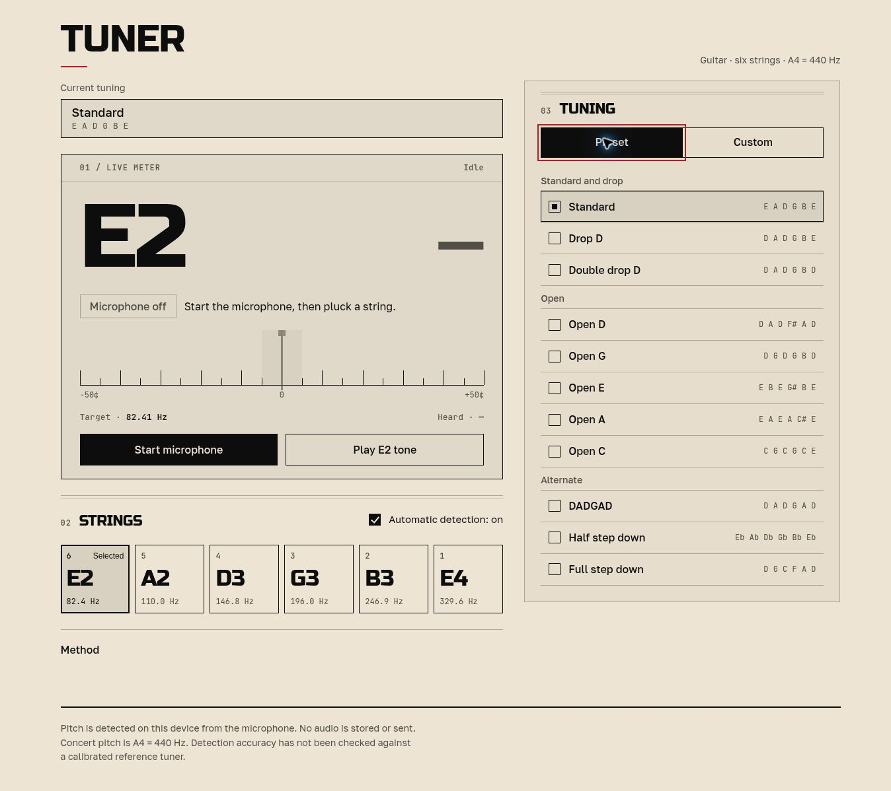

# Guitar Tuner

A six-string guitar tuner that analyzes pitch on your device. Eleven presets,
automatic or manual string selection, reference tones and relative custom tuning,
in the supplied Aporia Interface design. Built with strict vanilla TypeScript,
Vite and native Web Audio; zero production npm dependencies.



## Run locally

Use Node.js 26.13.1 LTS (`nvm use`); supported Node 24.22.1+ also works.

```sh
npm ci
npm run dev
```

Open the URL printed by Vite under `/guitar-tuner/`. Press **Start microphone**,
allow access and pluck one string at a time. Choose a string for manual selection,
or enable Automatic detection. Play its reference tone when needed; live analysis
pauses during playback. Stop the microphone to release input.

**Custom:** choose Custom, select a base tuning and string, start the microphone,
wait for a steady reading and record it. The other strings keep the base tuning's
intervals relative to that frequency. Selection and recording share the meter so
the mobile workflow stays together. Clear to start over; changing the base clears
the old reference. Presets and numeric calibration persist locally.

## Build and verify

```sh
npm test
npm run build
npx playwright install chromium
npm run test:e2e
# or run all gates:
npm run verify
```

Build output goes to ignored `dist/`, configured for `/guitar-tuner/`. Full test
commands, deterministic fixtures and actual verification results: [Testing](docs/testing.md).

## Deploy

Pages is prepared, **manual only**. In **Settings → Pages** choose **GitHub Actions**,
then run **Actions → Validate** on `main`. After it passes, run **Deploy GitHub Pages**
on `main`. Full steps and an opt-in future push trigger: [Deployment](docs/deployment.md).
No repository settings, Pages configuration or secrets are changed by the app.

## Microphone and privacy

Use HTTPS or localhost in a modern Web Audio browser. Microphone input requires
permission and a connected available device. Errors explain retry. Hiding the page
stops input and tone; returning does not reopen the microphone. Audio is neither
recorded nor uploaded. Only settings and the numeric reference stay in localStorage.
Optional Google Fonts requests match the reference; local fallback fonts work offline.

## Limits and verification status

Monophonic, 55–1000 Hz detection. A4=440 Hz for presets; Custom adjusts relative
pitch. Strong harmonics, chords, noisy rooms and a badly mistuned string can confuse
automatic selection; select the intended string manually. Older devices at high
sample rates may need performance work. Physical accuracy is uncalibrated.

74 unit tests and the production build passed. The live browser passed 11 workflow
checks plus responsive checks at four widths. The 39-case Playwright suite is
included but could not start in the implementation sandbox because Chromium's
required socket was denied. Run it locally or in CI before release. Safari/Firefox
and real-instrument accuracy are not yet verified. See [Testing](docs/testing.md).

## Documentation

| Guide | Contents |
| --- | --- |
| [Architecture](docs/architecture.md) | Module boundaries, YIN parameters and ownership decisions |
| [Design](docs/design.md) | Aporia source, token synchronization and focused UI changes |
| [Testing](docs/testing.md) | Evidence, browser checks and manual acceptance |
| [Deployment](docs/deployment.md) | Manual Pages deployment and Git-history restoration |
| [Development history](docs/history.md) | Incremental commits and delivery status |
| [Contributing](CONTRIBUTING.md) | Development and commit conventions |

## License

Apache-2.0. Aporia and the original tuner design by Parsa Jahanbani.
Retain [LICENSE](LICENSE) and [NOTICE](NOTICE) when redistributing.
